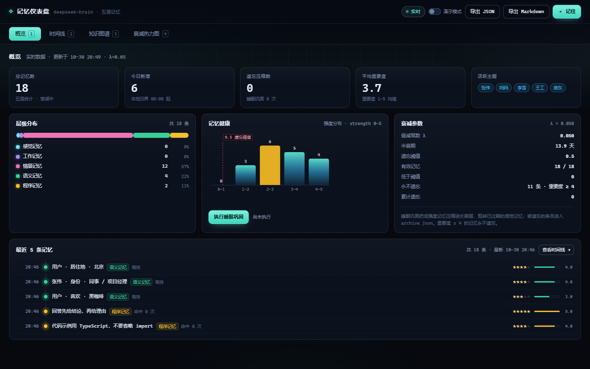
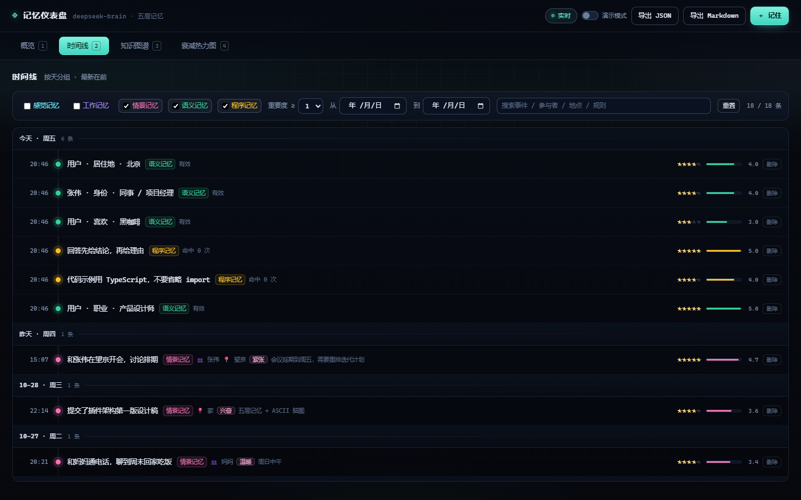
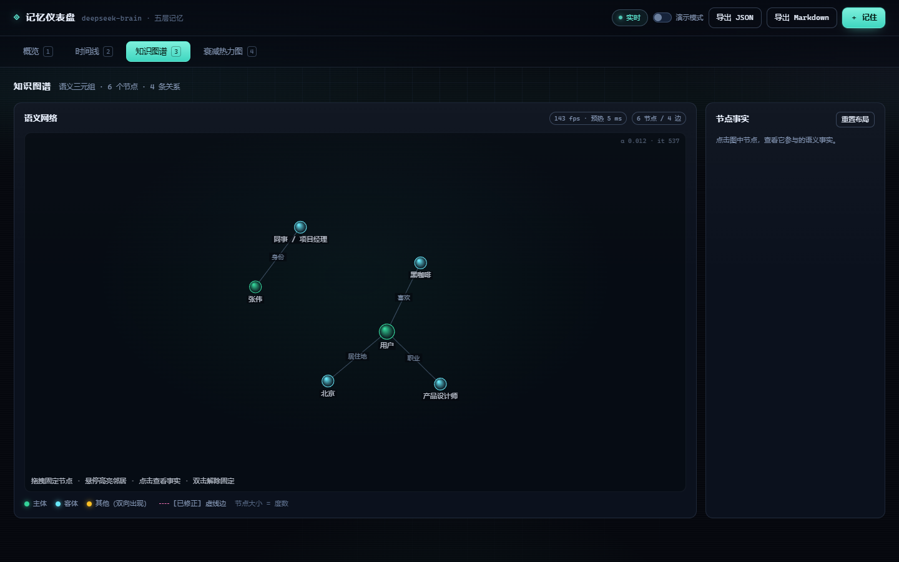
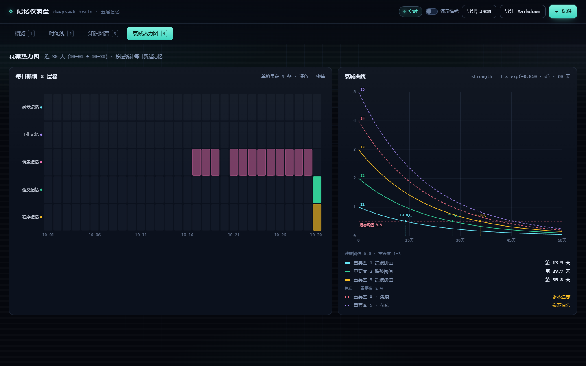
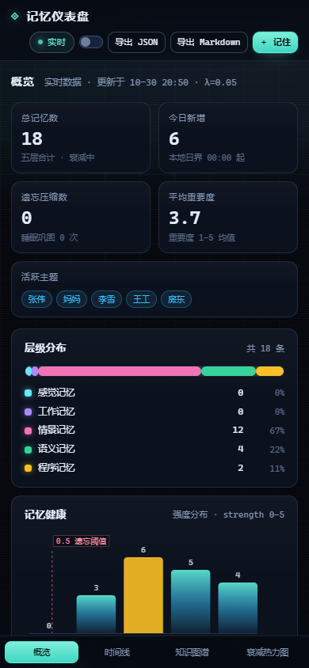
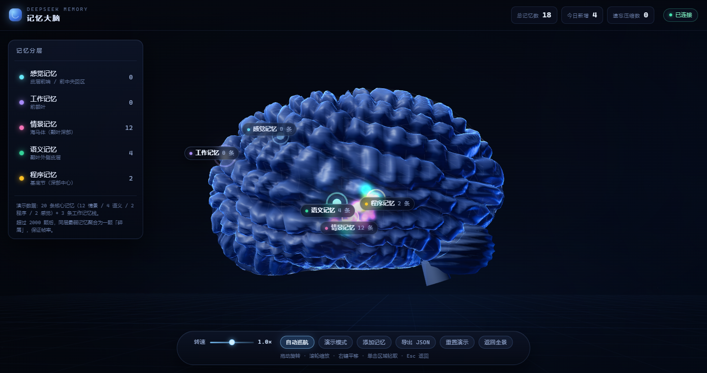
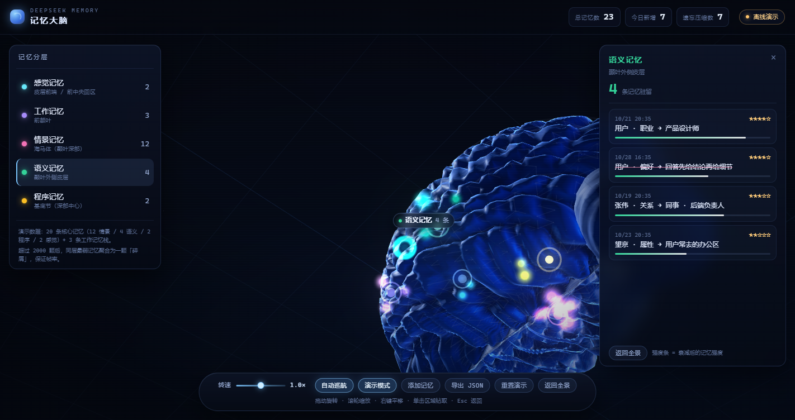
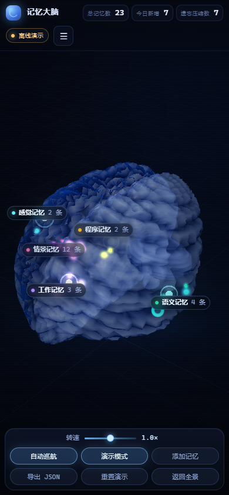

# deepseek-brain

一个给 DeepSeek Harness 用的**持久化类人生物大脑**插件：五层记忆、指数衰减遗忘、睡眠式巩固、知识图谱冲突修正、ASCII 脑图、Web 仪表盘，以及一个单文件的 Three.js 3D 记忆大脑。

零运行时依赖（纯 Node ESM），数据是 `~/.deepseek-brain/` 下的分层 JSON，随时可以打包搬走。

---

## 1. 安装

```bash
# 从 GitHub 安装（把 xxx 换成实际仓库地址）
dsh plugin --profile web add github:xxx/deepseek-brain

# 本地开发时用路径安装
dsh plugin add ./deepseek-brain
```

`web` 是 profile 名，换成你实际在用的那个（本机真实 profile 名是 `desktop`，已用 `dsh plugin --profile brain-selftest add ./deepseek-brain` 验证过安装链路：pnpm link 到 profile、`dsh.profile.bundles` 自动加入 `deepseek-brain`、`dsh --dump-config` 里能看到 `- id: deepseek-brain`）。

插件是标准 cordis 包：`cordis.patch.yml` 插入 `deepseek-brain` 行，`lib/index.js` 导出 `name` / `inject` / `apply`。
`inject: ['tools', 'systemPrompt']` 是硬依赖；`webServer` 用 `ctx.inject` 可选挂载，没有 Web 服务时 `brain_dashboard` 会自己起一个回环端口。

启动后模型立刻拿到工具与 System Prompt 注入（见第 4 节）。数据目录默认 `~/.deepseek-brain/`。

---

## 2. 架构

```
┌──────────────────────────── DSH agent turn ─────────────────────────────┐
│                                                                          │
│  user/message ──► session/event hook ──► SensoryBuffer (7±2, TTL 2s)     │
│                                              │ attended?                 │
│                                              ▼                           │
│                                       WorkingMemory (topic stack 4-7)    │
│                                              │                           │
│                              shouldRemember gate (重要度/实体/承诺词)     │
│                                              ▼                           │
│        ┌───────────────┬───────────────┬─────────────────┐               │
│        │ Episodic      │ Semantic      │ Procedural      │               │
│        │ 时间线+强度    │ 主体→关系→客体 │ 规则/习惯        │               │
│        │ 重要度×e^(-λt) │ 别名/冲突修正  │ 作为行为默认值    │               │
│        └───────┬───────┴───────┬───────┴────────┬────────┘               │
│                │               │                │                        │
│         decay / sleep consolidation（夜间空闲触发）                       │
│                ▼               ▼                ▼                        │
│            recall() ← 关键词 × 时间衰减 × 重要度 × (可选)向量相似度        │
│                │                                                         │
│                ├──► brain_recall  → tool result（带分数拆解）             │
│                ├──► promptBlock   → systemPrompt.context (order 130)     │
│                └──► apiState/HITP → 仪表盘 + 3D 大脑                      │
└──────────────────────────────────────────────────────────────────────────┘
```

### 与人脑记忆科学的对应

| 层 | 插件实现 | 神经科学对应 | 关键参数 |
| --- | --- | --- | --- |
| 感觉记忆 `sensory` | 每次输入解析实体（人名/时间/数字/地点/URL/情绪），7±2 槽，2 秒过期 | 图像/回声感觉登记（Atkinson–Shiffrin） | `sensoryCapacity`、`sensoryTtlMs` |
| 工作记忆 `working` | 话题栈，新话题 push 到顶，旧话题搁置，按会话隔离 | 前额叶工作记忆，容量 4±1 | `workingCapacity`（夹在 4–7） |
| 情景记忆 `episodic` | `{ts, event, participants, place, emotion, importance 1-5, detail}`，强度 `importance × exp(-λ·days)` | 海马体时间线情景痕迹 | `lambda`（默认 0.05/天）、`forgetThreshold` |
| 语义记忆 `semantic` | 三元组图谱 + 别名归一 + 冲突时旧条目 `status: corrected` 并保留 `supersededBy` | 颞叶语义网络 | `importance ≥ 4` 常驻 |
| 程序记忆 `procedural` | 习惯/规则清单，注入 System Prompt 作为默认行为，被使用时强度 +0.1 | 基底节程序性学习 | `procedural` 强度排序 + 前 8 条入 prompt |

三条不变量：

1. **永不物理删除**。`forget` 与衰减都写入 `archive.json`；语义冲突只标记 `[已修正]`。
2. **重要度 ≥ 4 永久保留**（`PINNED_IMPORTANCE`），不参与衰减清理。
3. **衰减是连续函数而非定时任务**：任一时刻的强度都由 `ts` 与 `λ` 现算，不需要后台心跳。

---

## 3. 三个使用示例

### 记住一件事

用户：「我叫林夕，是一名产品设计师，明天下午三点和张伟在望京开会。」

模型会直接调用：

```json
{
  "name": "brain_remember",
  "arguments": {
    "layer": "episodic",
    "event": "和张伟在望京开会，讨论排期",
    "participants": ["张伟"],
    "place": "望京",
    "emotion": "紧张",
    "importance": 4
  }
}
```

同一句话里的「我叫林夕 / 产品设计师」会被自动抽成语义三元组（`用户 → 姓名 → 林夕`、`用户 → 职业 → 产品设计师`）。也可以显式写语义：

```json
{ "layer": "semantic", "subject": "用户", "relation": "职业", "object": "产品设计师", "importance": 5 }
```

### 回忆一件事

用户：「上次跟张伟那个会怎么样了？」

```json
{ "name": "brain_recall", "arguments": { "query": "张伟 会议 排期", "topK": 6 } }
```

返回按 `关键词 0.55 + 重要度 0.2 + 新鲜度 0.2 + 层级 0.05`（可选向量 0.3）排序的命中，并附带分数拆解，模型据此说「你之前说过会议延期到周五」。

### 查看大脑可视化

```json
{ "name": "brain_visualize", "arguments": {} }
```

```
┌─ 工作记忆 · 话题栈（栈顶=当前焦点） ─────────────────────┐
│ ▸ 项目排期                                               │
│ 容量 1/7 · 顶部话题决定回答焦点                          │
├─ 情景记忆（近期 · 强度=重要度×e^(-λt)） ─────────────────┤
│ ● 10-30 会议延期 ★★★★☆ s=3.40                           │
├─ 语义记忆（主体 → 关系 → 客体） ─────────────────────────┤
│ 用户 → 职业 → 设计师                                     │
├─ 程序记忆（行为默认值） ─────────────────────────────────┤
│ ⚙ 先给结论                                              │
├─ 感觉记忆（7±2 槽 · 存活 2 秒） ─────────────────────────┤
│ ◇ 明天三点开会 人:张伟 时:明天                           │
└──────────────────────────────────────────────────────────┘

┌─ 记忆健康面板 ───────────────────────────────────────────┐
│ 总记忆数      3                                          │
│ 本周新增      1                                          │
│ 遗忘压缩数    2                                          │
│ 睡眠巩固次数  1                                          │
│ 平均重要度    4.00                                       │
│ 活跃主题      —                                          │
│ 分层条数      感觉 1 · 工作 1 · 情景 1 · 语义 1 · 程序 1 │
│ 最近巩固      尚未发生                                   │
└──────────────────────────────────────────────────────────┘
```

另有 `brain_sleep`（立即巩固）、`brain_forget`（软删除到 archive）、`brain_snapshot`（Markdown/JSON 档案）、`brain_dashboard`（启动仪表盘并回传 URL）。

同样的三件事不经过对话也能做——`curl` / `Invoke-RestMethod` / Node 三种入口的完整命令见 [`docs/EXAMPLES.md`](docs/EXAMPLES.md)，HTTP 契约见 [`docs/API.md`](docs/API.md)。

---

## 4. 工具与 System Prompt

| 工具 | 作用 | 关键参数 |
| --- | --- | --- |
| `brain_remember` | 写入五层中的一层 | `layer`(必填) `event` `participants` `place` `emotion` `detail` `importance` `subject` `relation` `object` `rule` `ts` |
| `brain_recall` | 检索 top-K，返回分数拆解 | `query`(必填) `topK` `layers` |
| `brain_visualize` | ASCII 脑图 + 健康面板 | — |
| `brain_forget` | 软删除到 `archive.json` | `id` |
| `brain_sleep` | 衰减清理 + 睡眠巩固 | `minAgeHours` |
| `brain_snapshot` | 导出 Markdown / JSON 档案 | `format` |
| `brain_dashboard` | 启动或复用本地仪表盘，返回 URL | — |

注入到 System Prompt 的内容（`order: 130`，`interpolate: false`）包含五条铁律、当前话题栈焦点、程序记忆规则、高权重情景记忆与实体归一表：

```
你拥有一个持久化的类人生物大脑（五层记忆：感觉 / 工作 / 情景 / 语义 / 程序）。铁律：
① 回答前先调用 brain_recall 检索相关记忆，禁止凭空“想起”；检索不到就明说没有记录。
② 用户给出姓名 / 日期 / 承诺 / 偏好时，立即调用 brain_remember 写入对应层。
③ 提到旧话题时自然带出过往细节（“你之前说过……”），但只使用检索到的内容。
④ 记忆冲突时用 brain_remember 叠加新事实，旧事实会自动标记 [已修正]，永不物理删除。
⑤ 重要度 ≥ 4 的记忆永不忘，低价值记忆随时间自然衰减；不要假装记得已被遗忘的事。
```

`interpolate: false` 是硬性要求：记忆里出现 `{{...}}` 时不会被当成模板变量求值。

---

## 5. 配置

插件配置直接在 `cordis.yml` 的插件条目里写（或用 `DEEPSEEK_BRAIN_DIR` 覆盖数据目录）：

```yaml
- id: deepseek-brain
  name: 'deepseek-brain'
  config:
    lambda: 0.05              # 衰减系数 λ（每天），越大忘得越快
    forgetThreshold: 0.5      # 强度低于该值且重要度<4 → 清理
    sensoryCapacity: 7        # 感觉缓冲槽位，夹在 3-9（7±2）
    sensoryTtlMs: 2000        # 感觉痕迹存活毫秒
    workingCapacity: 7        # 话题栈深度，夹在 4-7
    topK: 6                   # recall 默认返回条数
    autoCapture: true         # 自动把用户输入过闸门后写入情景记忆
    autoImportanceMin: 3      # 自动捕获的最低重要度
    promptInjection: true     # 是否注入 System Prompt
    dashboard: true           # 允许 brain_dashboard 起服务
    backupCount: 7            # 保留的备份版本数
    idleConsolidationHours: 12  # 空闲多久后允许自动巩固（0 关闭）
    minConsolidationAgeHours: 6 # 巩固时忽略的新记忆年龄
    vector:
      enabled: false          # 语义召回开关
      provider: hash          # hash（零依赖余弦）或 lancedb
    demoSeed: false           # 启动时灌入 20 条演示记忆
```

| 配置 | 默认 | 范围 | 说明 |
| --- | --- | --- | --- |
| `lambda` | `0.05` | 0.001–1 | 强度衰减率，`exp(-λ·天数)`；0.05 约 14 天减半 |
| `forgetThreshold` | `0.5` | 0.05–3 | 低于此强度进入清理；重要度 ≥4 免疫 |
| `sensoryCapacity` | `7` | 3–9 | 感觉槽位 |
| `sensoryTtlMs` | `2000` | 200–60000 | 感觉痕迹存活 |
| `workingCapacity` | `7` | 4–7 | 话题栈深度 |
| `topK` | `6` | 1–20 | recall 返回条数 |
| `autoImportanceMin` | `3` | 1–5 | 自动捕获门槛 |
| `backupCount` | `7` | 1–50 | 备份轮转保留数 |
| `idleConsolidationHours` | `12` | 0–240 | 夜间/空闲自动巩固间隔 |
| `minConsolidationAgeHours` | `6` | 0–720 | 巩固时跳过的年轻记忆 |
| `vector.enabled` | `false` | — | 开启后 recall 额外加向量相似度 0.3 |
| `vector.provider` | `hash` | `hash`/`lancedb` | `lancedb` 需自行 `npm i @lancedb/lancedb`；该分支只把数据库打开成扩展点，打分仍是内置余弦，模块缺失时自动降级并写入 `warnings` |
| `demoSeed` | `false` | — | 空库时灌入 20 条演示记忆 |

数据目录优先级：显式 `dataDir` > `DEEPSEEK_BRAIN_DIR` 环境变量 > `~/.deepseek-brain`。

### 落盘结构

```
~/.deepseek-brain/
├── episodic.json      # {version, items:[…]}
├── semantic.json      # {version, items:[…], aliases:{别名: 主体}}
├── procedural.json
├── stats.json         # counters / lastSleepAt / remembersByDay
├── archive.json       # 遗忘与手动删除的只增档案
├── backups/           # 每个文件的最近 7 个版本
│   └── episodic.json.2024-10-30T12-00-00-000Z.bak
├── snapshots/         # brain_snapshot 的 Markdown 档案
└── vectors/           # 可选向量索引（默认不生成）
```

写入是原子的：`*.tmp` → `rename`（Windows 上先删目标）。文件损坏时改名为 `*.corrupt-<ts>` 并从最近备份恢复；没有备份就重置为空库并在 `warnings` 里登记。

---

## 6. 可视化

### 6.0 不装插件也能先看

```bash
node tools/serve.mjs --demo        # → http://127.0.0.1:7801/deepseek-brain/
# 等价：npm run serve
```

它用的是插件挂到 DSH `webServer` 上的**同一个** `lib/server.js` handler，所以预览里看到的和 `brain_dashboard` 返回的完全一致：仪表盘、3D 大脑、`api/state` 都在同一个端口上。数据目录默认就是 `~/.deepseek-brain`，`--data ./tmp` 换地方、`--port 7802` 换端口、不传 `--demo` 则只在空库时播种。

### 6.1 对话内：`brain_visualize`

ASCII 脑图（见第 3 节）+ 健康面板：总记忆数、本周新增、遗忘压缩数、巩固次数、平均重要度、活跃主题、分层条数、最近巩固时间。框线按 CJK 双宽对齐，终端里不会撕裂。

### 6.2 Web 仪表盘

`brain_dashboard` → 返回 `…/deepseek-brain/dashboard.html`。四个视图（hash 路由，键盘 `1–4`）：

- **概览**：5 张 KPI、层堆叠条、强度直方图、一键睡眠巩固。
- **时间线**：窗口化虚拟列表，按天分组，支持层/重要度/关键词/日期筛选与行内两步删除。
- **知识图谱**：自写力导向 Canvas，修正过的三元组画虚线并带 `[已修正]` 与上一版 tooltip。
- **衰减热力图**：5 层 × 30 天密度矩阵 + 按当前 λ 绘制的 60 天衰减曲线与遗忘阈值穿越天数。

API 挂在 `/deepseek-brain/api/*`，契约见 [`docs/API.md`](docs/API.md)：

```
GET  /api/state        GET /api/health      GET /api/export.json   GET /api/snapshot.md
POST /api/remember     POST /api/forget     POST /api/sleep        POST /api/decay
POST /api/working/push
```

全部端点带 `Access-Control-Allow-Origin: *`，方便单独打开的 HTML 直接连。



| 时间线 | 知识图谱 |
| --- | --- |
|  |  |

| 衰减热力图 | 手机（390 px） |
| --- | --- |
|  |  |

### 6.3 3D 记忆大脑

- `web/brain-3d.html`：开发版，`vendor/three.global.min.js` 外链，作为插件静态资源由 `/deepseek-brain/brain-3d.html` 提供，读实时 `/api/state`。
- `dist/deepseek-brain-3d.html`：构建产物，three.js 内联进同一个文件，双击即开、离线可用，此时用内置 20 条演示记忆。

```bash
node tools/build-3d.mjs      # 生成 dist/deepseek-brain-3d.html
```

**手势（Pointer Events，鼠标与触屏同一套）**

| 操作 | 鼠标 | 触屏 | 效果 |
| --- | --- | --- | --- |
| 旋转 | 左键拖拽 | 单指拖拽 | 360° 环绕大脑 |
| 缩放 | 滚轮 | 双指捏合 | 拉近看脑沟回 |
| 平移 | 右键拖拽 | 双指拖拽 | 平移视点 |
| 选中 | 单击脑区/粒子 | 单指点击 | 相机平滑飞入 + 记忆详情面板 |
| 复位 | 双击空白 / 复位按钮 | 双击 | 回到全景视角 |

底部滑杆控制自转速度，可开关自动巡航与演示模式；左侧五层列表点击即定位到对应脑区。



| 点击脑区后飞入（真实 CDP 点击） | 手机（390 px） |
| --- | --- |
|  |  |

**几何与脑区映射**（`BRAIN = {AX 1.24, AY 1.35, AZ 2.04}`，约 1 : 1.09 : 1.65）

- 两个**闭合**半球：内侧顶点被 softMax 折到 `x ≈ ±gapHalf` 的墙面上，两壁之间是真缝（纵裂），槽旁有皮层隆起与两条顶点色高光，内壁压成近黑。
- 沟回是两族倾斜板（相位 `zl*22 + y*11` 与 `y*19 - zl*7`）叠加 3 阶 fbm 扭曲，`sul = pow(0.5-0.5cos(phase), 5)`，峰值到谷值约 0.12–0.15 世界单位；中央沟与外侧裂用固定坐标写死。
- 材质 `MeshPhysicalMaterial`（transmission / clearcoat / ior）+ 高画质档额外一层菲涅尔外壳；低画质档退化为 `MeshStandardMaterial`。
- 五个脑区：感觉记忆→皮质前端，工作记忆→前额叶，情景记忆→海马体（颞叶深部），语义记忆→颞叶外侧皮层，程序记忆→基底节（深部）；每区有光球、脉冲环与 DOM 计数标签，深部锚点不做背面剔除。

**性能（目标 60 fps，含移动端）**

| 手段 | 说明 |
| --- | --- |
| 单缓冲粒子 | 全部记忆是**一个** `THREE.Points` + 自定义 `ShaderMaterial`，每个粒子用 `aSize/aColor/aGlow/aShape` 顶点属性区分；按 id 差量同步，不在帧内重建几何 |
| 绘制上限 | 预分配 `MAX_PARTICLES = 2000` 并用 `setDrawRange` 控制实际绘制量；超出后每层聚合成一个「碎屑」环，左侧图例有说明 |
| 零帧内分配 | 渲染循环里复用模块级 `Vector3` 临时量，避免每帧 GC 抖动 |
| 拾取开销 | 射线只打 5 个不可见代理球，不打高面数大脑网格 |
| 画质分档 | `hardwareConcurrency ≤ 4 / dpr×width > 2600 / 视口短边 < 720` 时自动降级：关抗锯齿、`pixelRatio` ≤ 1.5、网格分段 104×78 而非 192×144、去掉线框层、用普通透明材质替代透射材质、星点 1100→520 |
| 离屏暂停 | `document.hidden` 或 `IntersectionObserver` 判定不可见时不渲染 |
| 抗抖动 | 惯性阻尼 + `prefers-reduced-motion` 下直接跳切镜头，不做长动画 |
| 调试 | 按 `d` 显示 `renderer.info`（draw calls / triangles / 帧耗） |

---

## 7. 测试与调试

```bash
node --test test/            # 48 个用例：分层算法 / 存储 / 记忆系统 / HTTP API / 插件契约 / 前端产物
node tools/demo.mjs          # 灌入 20 条演示记忆并打印脑图
DEEPSEEK_BRAIN_DIR=/tmp/brain node tools/demo.mjs   # 用临时数据目录，不碰真实记忆
```

用例覆盖：

| 文件 | 覆盖 |
| --- | --- |
| `test/layers.test.js` | 实体抽取、注意闸门、话题栈与小话题过滤、情景衰减与钉住、语义别名/冲突历史、程序记忆去重、巩固摘要、检索权重、ASCII 对齐、Markdown 档案 |
| `test/store.test.js` | 原子写、备份轮转上限、损坏文件隔离与恢复 |
| `test/memory.test.js` | 落盘/重启后记忆存活、观察闸门、recall、软删除、衰减清理、睡眠巩固、`apiState` 契约、演示数据、prompt 块、配置夹取 |
| `test/server.test.js` | 全端点、CORS/预检、静态资源、路径穿越拒绝、坏 JSON 结构化报错 |
| `test/plugin.test.js` | cordis 契约、7 个工具 schema 只使用 DSH 支持的 JSON Schema 子集、端到端工具调用、`session/event` 捕获、prompt 注入 |
| `test/frontend.test.js` | 两个页面无远程依赖、内联脚本可编译、3D 页引用 vendor + `api/state` + 五层名称、`dist` 单文件把 three.js 内联且无外链 |

调试入口：

- `GET /deepseek-brain/api/health`：数据目录、各层条数、备份数、向量状态、`warnings`。
- 脑图底部「记忆健康面板」就是同一份统计的可读版。
- 想看某条为什么被召回：`recall` 的 `parts` 里有 `keyword / importance / freshness / vector` 四个分量。
- 插件初始化失败不会炸掉会话，错误进 `memory.warnings` 并在 `api/health` 里可见。

### 7.1 本机实测记录

| 项 | 结果 |
| --- | --- |
| `node --test test/` | 48 pass / 0 fail |
| 真实安装 | `dsh plugin --profile brain-selftest add ./deepseek-brain` → pnpm link 成功，`dsh.profile.bundles` 自动写入 `deepseek-brain`，`dsh --dump-config` 出现 `- id: deepseek-brain` |
| 真实 HTTP | `dashboard.html` / `brain-3d.html` / `vendor/three.global.min.js` / `api/state` 全部 200，`api/state` 7.7 KB，regions 计数与库内条数一致 |
| 20 天剧本（λ=0.08） | sleep `{"migrated":3,"compressed":0,"pruned":0,"digests":0,"kept":9}`，重载后 episodic 9 条、archive 与 backups 一致 |
| 3D 交互 | 用 Chrome DevTools Protocol 真实点击脑区：相机飞入、面板列出该区条目（时间/星级/强度/删除），`返回全景` 可复位；POST `/api/remember` 后 4 s 轮询内顶栏计数与粒子同步 |
| 移动端 | 390×844 真视口下仪表盘四视图无横向溢出，3D 底栏三列两行完整 |

3D 页另外有一份离线冒烟：`web/brain-3d.html` 复制到没有 `vendor/` 的目录会显示可读错误卡而不是白屏。

---

## 8. 目录

```
deepseek-brain/
├── cordis.patch.yml          # DSH bundle 插入声明
├── package.json              # main: lib/index.js, dsh.bundle.patch
├── lib/
│   ├── index.js              # 插件入口：7 个工具 + prompt 注入 + 事件捕获 + Web 挂载
│   ├── memory.js             # MemorySystem：五层编排、配置、状态、prompt 块、演示数据
│   ├── store.js              # 原子写、备份轮转、损坏恢复
│   ├── sensory.js            # 感觉缓冲 + 实体抽取 + 注意闸门
│   ├── working.js            # 话题栈 + 话题检测
│   ├── episodic.js           # 情景记忆 + 指数衰减
│   ├── semantic.js           # 三元组图谱 + 别名合并 + 冲突修正
│   ├── procedural.js         # 规则/习惯
│   ├── retrieval.js          # 检索引擎与分数拆解
│   ├── consolidation.js      # 睡眠式巩固
│   ├── vector.js             # 可选向量召回（hash / lancedb）
│   ├── render.js             # ASCII 脑图与健康面板
│   ├── snapshot.js           # Markdown 记忆档案
│   └── server.js             # 仪表盘 + JSON API
├── web/
│   ├── brain-3d.html         # 3D 大脑（开发版，外链 three）
│   ├── dashboard.html        # 仪表盘（单文件）
│   └── vendor/               # three.js 全局构建
├── dist/deepseek-brain-3d.html  # 单文件 3D 大脑（构建产物）
├── tools/                    # serve（本地预览）/ demo / build-3d / build-global-three
├── test/                     # 48 个 Node 原生测试
├── docs/
│   ├── API.md                # 前端契约（端点 + state JSON 结构 + 脑区锚点）
│   ├── EXAMPLES.md           # 三个示例的 curl / PowerShell / Node 入口
│   └── screenshots/          # 仪表盘四视图与 3D 大脑截图
```

## 9. 边界

- 记忆只存在本机，插件不做任何网络请求；仪表盘监听 `127.0.0.1`。
- 自动捕获有闸门（问候、过短、纯提问不写入），避免垃圾记忆污染；仍建议用 `importance` 与 `brain_forget` 维护。
- `vector` 默认关闭。`hash` provider 只是字符级哈希相似度，不是真正的语义嵌入；接 LanceDB 时可以注入自己的 embedding。
- Windows 上文件写入走「删目标再 rename」的回退路径，极端断电窗口内可能丢一次写入，但有备份兜底。
- 3D 页面在 `file://` 下无法访问 API，会自动切到内置演示记忆；实时数据请走 `brain_dashboard` 给出的 URL。
- 3D 大脑是**程序化近似**，不是医学模型：沟回由两族倾斜板 + fbm 扭曲生成，近景局部会看出「平行香肠排」，缺少一级沟→次级沟的尺度递进；额极/枕极偏圆钝；小脑叶片是正弦条纹，远看合格、近看机械。默认视角为了保住纵裂可读性压低了方位角，前后 1.65 的长宽比在投影上不明显，转到侧位才能看清。
- Windows PowerShell 的 `Invoke-RestMethod` 默认按 ANSI 发 body，中文会变成 `??`；用 `[Text.Encoding]::UTF8.GetBytes($body)`（见 `docs/EXAMPLES.md`）。
- 仪表盘时间线在 390 px 下隐藏层标签与强度条，层身份只剩颜色；1024×768 概览仍需纵向滚动。

MIT License.
