# deepseek-brain

一个给 DeepSeek Harness 用的**持久化类人生物大脑**插件：五层记忆、指数衰减遗忘、睡眠式巩固、知识图谱冲突修正、ASCII 脑图、Web 仪表盘，以及一个单文件的 Three.js 3D 记忆大脑。

零运行时依赖（纯 Node ESM），数据是 `~/.deepseek-brain/` 下的分层 JSON，随时可以打包搬走。

---

## 1. 安装

```bash
# 从 GitHub 安装（把 xxx 换成实际仓库地址）
dsh plugin --profile web add github:xxx/deepseek-brain

# 本地开发时用路径安装
dsh plugin add ./deepseek-brain
```

`web` 是 profile 名，换成你实际在用的那个（本机真实 profile 名是 `desktop`，已用 `dsh plugin --profile brain-selftest add ./deepseek-brain` 验证过安装链路：pnpm link 到 profile、`dsh.profile.bundles` 自动加入 `deepseek-brain`、`dsh --dump-config` 里能看到 `- id: deepseek-brain`）。

插件是标准 cordis 包：`cordis.patch.yml` 插入 `deepseek-brain` 行，`lib/index.js` 导出 `name` / `inject` / `apply`。
`inject: ['tools', 'systemPrompt']` 是硬依赖；`webServer` 用 `ctx.inject` 可选挂载，没有 Web 服务时 `brain_dashboard` 会自己起一个回环端口。

启动后模型立刻拿到工具与 System Prompt 注入（见第 4 节）。数据目录默认 `~/.deepseek-brain/`。

---

## 2. 架构

```
┌──────────────────────────── DSH agent turn ─────────────────────────────┐
│                                                                          │
│  user/message ──► session/event hook ──► SensoryBuffer (7±2, TTL 2s)     │
│                                              │ attended?                 │
│                                              ▼                           │
│                                       WorkingMemory (topic stack 4-7)    │
│                                              │                           │
│                              shouldRemember gate (重要度/实体/承诺词)     │
│                                              ▼                           │
│        ┌───────────────┬───────────────┬─────────────────┐               │
│        │ Episodic      │ Semantic      │ Procedural      │               │
│        │ 时间线+强度    │ 主体→关系→客体 │ 规则/习惯        │               │
│        │ 重要度×e^(-λt) │ 别名/冲突修正  │ 作为行为默认值    │               │
│        └───────┬───────┴───────┬───────┴────────┬────────┘               │
│                │               │                │                        │
│         decay / sleep consolidation（夜间空闲触发）                       │
│                ▼               ▼                ▼                        │
│            recall() ← 关键词 × 时间衰减 × 重要度 × (可选)向量相似度        │
│                │                                                         │
│                ├──► brain_recall  → tool result（带分数拆解）             │
│                ├──► promptBlock   → systemPrompt.context (order 130)     │
│                └──► apiState/HITP → 仪表盘 + 3D 大脑                      │
└──────────────────────────────────────────────────────────────────────────┘
```

### 与人脑记忆科学的对应

| 层 | 插件实现 | 神经科学对应 | 关键参数 |
| --- | --- | --- | --- |
| 感觉记忆 `sensory` | 每次输入解析实体（人名/时间/数字/地点/URL/情绪），7±2 槽，2 秒过期 | 图像/回声感觉登记（Atkinson–Shiffrin） | `sensoryCapacity`、`sensoryTtlMs` |
| 工作记忆 `working` | 话题栈，新话题 push 到顶，旧话题搁置，按会话隔离 | 前额叶工作记忆，容量 4±1 | `workingCapacity`（夹在 4–7） |
| 情景记忆 `episodic` | `{ts, event, participants, place, emotion, importance 1-5, detail}`，强度 `importance × exp(-λ·days)` | 海马体时间线情景痕迹 | `lambda`（默认 0.05/天）、`forgetThreshold` |
| 语义记忆 `semantic` | 三元组图谱 + 别名归一 + 冲突时旧条目 `status: corrected` 并保留 `supersededBy` | 颞叶语义网络 | `importance ≥ 4` 常驻 |
| 程序记忆 `procedural` | 习惯/规则清单，注入 System Prompt 作为默认行为，被使用时强度 +0.1 | 基底节程序性学习 | `procedural` 强度排序 + 前 8 条入 prompt |

三条不变量：

1. **永不物理删除**。`forget` 与衰减都写入 `archive.json`；语义冲突只标记 `[已修正]`。
2. **重要度 ≥ 4 永久保留**（`PINNED_IMPORTANCE`），不参与衰减清理。
3. **衰减是连续函数而非定时任务**：任一时刻的强度都由 `ts` 与 `λ` 现算，不需要后台心跳。

---

## 3. 三个使用示例

### 记住一件事

用户：「我叫林夕，是一名产品设计师，明天下午三点和张伟在望京开会。」

模型会直接调用：

```json
{
  "name": "brain_remember",
  "arguments": {
    "layer": "episodic",
    "event": "和张伟在望京开会，讨论排期",
    "participants": ["张伟"],
    "place": "望京",
    "emotion": "紧张",
    "importance": 4
  }
}
```

同一句话里的「我叫林夕 / 产品设计师」会被自动抽成语义三元组（`用户 → 姓名 → 林夕`、`用户 → 职业 → 产品设计师`）。也可以显式写语义：

```json
{ "layer": "semantic", "subject": "用户", "relation": "职业", "object": "产品设计师", "importance": 5 }
```

### 回忆一件事

用户：「上次跟张伟那个会怎么样了？」

```json
{ "name": "brain_recall", "arguments": { "query": "张伟 会议 排期", "topK": 6 } }
```

返回按 `关键词 0.55 + 重要度 0.2 + 新鲜度 0.2 + 层级 0.05`（可选向量 0.3）排序的命中，并附带分数拆解，模型据此说「你之前说过会议延期到周五」。

### 查看大脑可视化

```json
{ "name": "brain_visualize", "arguments": {} }
```

```
┌─ 工作记忆 · 话题栈（栈顶=当前焦点） ─────────────────────┐
│ ▸ 项目排期                                               │
│ 容量 1/7 · 顶部话题决定回答焦点                          │
├─ 情景记忆（近期 · 强度=重要度×e^(-λt)） ─────────────────┤
│ ● 10-30 会议延期 ★★★★☆ s=3.40                           │
├─ 语义记忆（主体 → 关系 → 客体） ─────────────────────────┤
│ 用户 → 职业 → 设计师                                     │
├─ 程序记忆（行为默认值） ─────────────────────────────────┤
│ ⚙ 先给结论                                              │
├─ 感觉记忆（7±2 槽 · 存活 2 秒） ─────────────────────────┤
│ ◇ 明天三点开会 人:张伟 时:明天                           │
└──────────────────────────────────────────────────────────┘

┌─ 记忆健康面板 ───────────────────────────────────────────┐
│ 总记忆数      3                                          │
│ 本周新增      1                                          │
│ 遗忘压缩数    2                                          │
│ 睡眠巩固次数  1                                          │
│ 平均重要度    4.00                                       │
│ 活跃主题      —                                          │
│ 分层条数      感觉 1 · 工作 1 · 情景 1 · 语义 1 · 程序 1 │
│ 最近巩固      尚未发生                                   │
└──────────────────────────────────────────────────────────┘
```

另有 `brain_sleep`（立即巩固）、`brain_forget`（软删除到 archive）、`brain_update`（就地修订，不新建不删除）、`brain_conflicts`（列出 `[已修正]` 的事实及当前值）、`brain_restore`（把旧值放回生效位）、`brain_import`（并入另一台设备的档案，只做加法）、`brain_snapshot`（Markdown/JSON 档案）、`brain_dashboard`（启动仪表盘并回传 URL）。

同样的三件事不经过对话也能做——`curl` / `Invoke-RestMethod` / Node 三种入口的完整命令见 [`docs/EXAMPLES.md`](docs/EXAMPLES.md)，HTTP 契约见 [`docs/API.md`](docs/API.md)。

---

## 4. 工具与 System Prompt

| 工具 | 作用 | 关键参数 |
| --- | --- | --- |
| `brain_remember` | 写入五层中的一层 | `layer`(必填) `event` `participants` `place` `emotion` `detail` `importance` `subject` `relation` `object` `rule` `ts` |
| `brain_recall` | 检索 top-K，返回分数拆解 | `query`(必填) `topK` `layers` |
| `brain_visualize` | ASCII 脑图 + 健康面板 | — |
| `brain_update` | 就地修订一条记忆（情景字段 / 语义 object / 程序 rule），保留历史 | `id`(必填) `importance` `event` `detail` `place` `emotion` `object` `rule` |
| `brain_history` | 看一条记忆的版本链（v1 … 当前），回答「之前到底是怎么说的」 | `id`(必填) |
| `brain_conflicts` | 列出被修正的事实与当前生效值 | — |
| `brain_restore` | 把某条 `[已修正]` 的旧值放回生效位 | `id`(必填) |
| `brain_prune_conflicts` | 每个槽位只留最近 N 条旧值，其余软归档到 `archive.json`（先给预演） | `keep` `subject` `relation` `dryRun` |
| `brain_archive` | 查归档区（遗忘 / 清理 / 手动归档）并取回，单条或批量 | `query` `layer` `limit` `id` `ids` |
| `brain_import` | 并入另一份 export（只做加法，冲突跳过） | `path` 或 `json` |
| `brain_forget` | 软删除到 `archive.json` | `id` |
| `brain_sleep` | 衰减清理 + 睡眠巩固 | `minAgeHours` |
| `brain_snapshot` | 导出 Markdown / JSON 档案 | `format` |
| `brain_dashboard` | 启动或复用本地仪表盘，返回 URL | — |

注入到 System Prompt 的内容（`order: 130`，`interpolate: false`）包含五条铁律、当前话题栈焦点、程序记忆规则、高权重情景记忆与实体归一表：

```
你拥有一个持久化的类人生物大脑（五层记忆：感觉 / 工作 / 情景 / 语义 / 程序）。铁律：
① 回答前先调用 brain_recall 检索相关记忆，禁止凭空“想起”；检索不到就明说没有记录。
② 用户给出姓名 / 日期 / 承诺 / 偏好时，立即调用 brain_remember 写入对应层。
③ 提到旧话题时自然带出过往细节（“你之前说过……”），但只使用检索到的内容。
④ 记忆冲突时用 brain_remember 叠加新事实，旧事实会自动标记 [已修正]，永不物理删除。
⑤ 重要度 ≥ 4 的记忆永不忘，低价值记忆随时间自然衰减；不要假装记得已被遗忘的事。
```

`interpolate: false` 是硬性要求：记忆里出现 `{{...}}` 时不会被当成模板变量求值。

---

## 5. 配置

插件配置直接在 `cordis.yml` 的插件条目里写（或用 `DEEPSEEK_BRAIN_DIR` 覆盖数据目录）：

```yaml
- id: deepseek-brain
  name: 'deepseek-brain'
  config:
    lambda: 0.05              # 衰减系数 λ（每天），越大忘得越快
    forgetThreshold: 0.5      # 强度低于该值且重要度<4 → 清理
    sensoryCapacity: 7        # 感觉缓冲槽位，夹在 3-9（7±2）
    sensoryTtlMs: 2000        # 感觉痕迹存活毫秒
    workingCapacity: 7        # 话题栈深度，夹在 4-7
    topK: 6                   # recall 默认返回条数
    autoCapture: true         # 自动把用户输入过闸门后写入情景记忆
    autoImportanceMin: 3      # 自动捕获的最低重要度
    promptInjection: true     # 是否注入 System Prompt
    dashboard: true           # 允许 brain_dashboard 起服务
    backupCount: 7            # 保留的备份版本数
    idleConsolidationHours: 12  # 空闲多久后允许自动巩固（0 关闭）
    minConsolidationAgeHours: 6 # 巩固时忽略的新记忆年龄
    autoDecayMinutes: 30      # 自主遗忘扫描间隔（分钟），0 关闭
    activityLimit: 240        # 活动流环形缓冲长度
    vector:
      enabled: false          # 语义召回开关
      provider: hash          # hash（零依赖余弦）或 lancedb
    demoSeed: false           # 启动时灌入 20 条演示记忆
```

| 配置 | 默认 | 范围 | 说明 |
| --- | --- | --- | --- |
| `lambda` | `0.05` | 0.001–1 | 强度衰减率，`exp(-λ·天数)`；0.05 约 14 天减半 |
| `forgetThreshold` | `0.5` | 0.05–3 | 低于此强度进入清理；重要度 ≥4 免疫 |
| `sensoryCapacity` | `7` | 3–9 | 感觉槽位 |
| `sensoryTtlMs` | `2000` | 200–60000 | 感觉痕迹存活 |
| `workingCapacity` | `7` | 4–7 | 话题栈深度 |
| `topK` | `6` | 1–20 | recall 返回条数 |
| `autoImportanceMin` | `3` | 1–5 | 自动捕获门槛 |
| `backupCount` | `7` | 1–50 | 备份轮转保留数 |
| `idleConsolidationHours` | `12` | 0–240 | 夜间/空闲自动巩固间隔 |
| `minConsolidationAgeHours` | `6` | 0–720 | 巩固时跳过的年轻记忆 |
| `autoDecayMinutes` | `30` | 0–1440 | 自主遗忘扫描间隔：到点自动 `decayPass()`，弱记忆进 `archive.json`；`0` 关闭 |
| `activityLimit` | `240` | 20–2000 | 活动流保留条数（3D / 仪表盘的事件源） |
| `vector.enabled` | `false` | — | 开启后 recall 额外加向量相似度 0.3 |
| `vector.provider` | `hash` | `hash`/`lancedb` | `lancedb` 需自行 `npm i @lancedb/lancedb`；该分支只把数据库打开成扩展点，打分仍是内置余弦，模块缺失时自动降级并写入 `warnings` |
| `demoSeed` | `false` | — | 空库时灌入 20 条演示记忆 |

数据目录优先级：显式 `dataDir` > `DEEPSEEK_BRAIN_DIR` 环境变量 > `~/.deepseek-brain`。

### 落盘结构

```
~/.deepseek-brain/
├── episodic.json      # {version, items:[…]}
├── semantic.json      # {version, items:[…], aliases:{别名: 主体}}
├── procedural.json
├── stats.json         # counters / lastSleepAt / remembersByDay
├── archive.json       # 遗忘与手动删除的只增档案
├── backups/           # 每个文件的最近 7 个版本
│   └── episodic.json.2024-10-30T12-00-00-000Z.bak
├── snapshots/         # brain_snapshot 的 Markdown 档案
└── vectors/           # 可选向量索引（默认不生成）
```

写入是原子的：`*.tmp` → `rename`（Windows 上先删目标）。文件损坏时改名为 `*.corrupt-<ts>` 并从最近备份恢复；没有备份就重置为空库并在 `warnings` 里登记。

---

## 6. 可视化

### 6.0 不装插件也能先看

```bash
node tools/serve.mjs --demo        # → http://127.0.0.1:7801/deepseek-brain/
# 等价：npm run serve
```

它用的是插件挂到 DSH `webServer` 上的**同一个** `lib/server.js` handler，所以预览里看到的和 `brain_dashboard` 返回的完全一致：仪表盘、3D 大脑、`api/state` 都在同一个端口上。数据目录默认就是 `~/.deepseek-brain`，`--data ./tmp` 换地方、`--port 7802` 换端口、不传 `--demo` 则只在空库时播种。

### 6.1 对话内：`brain_visualize`

ASCII 脑图（见第 3 节）+ 健康面板：总记忆数、本周新增、遗忘压缩数、巩固次数、平均重要度、活跃主题、分层条数、最近巩固时间。框线按 CJK 双宽对齐，终端里不会撕裂。

### 6.2 记忆观测仪（仪表盘）

`brain_dashboard` → 返回 `…/deepseek-brain/dashboard.html`。它不是「数据看板」，是一台**观测仪**：骨白与墨色、宋体标题、等宽数字、压印按钮，没有任何圆角渐变卡片。四页（hash 路由，键盘 `1–4`）：

- **概览 VITALS**：脑区度数表（五层的条数/占比/平均强度）+ 14 天生命体征示波器（新增/遗忘/巩固/巩固次数四条迹线）+ 读数板（λ、半衰期、遗忘阈值、Pinned 条数、数据目录、备份数、向量索引、当前会话）+ 检索台（真正 `POST /api/recall`，把分数四分量列出来）。
- **编年史 CHRONICLE**：右上角「归档区」按钮打开归档抽屉——遗忘、清理、手动归档的记忆都在里面，可按关键词与层级筛，点「取回」就回到原来的层继续参与检索与衰减；勾选多条可以「取回选中 (n)」，取回后 8 秒内还能「撤销取回」把它送回归档区。等宽表格虚拟滚动，每条给出「强度预报」——`还剩 31.2 日 · 强度 0.50` 或 `免疫 · Imp 5`，直接读服务端 `forgetInDays`，不在前端重算公式。点任意一行打开**版本链抽屉**：`v1 … vN` 分开标注当前版与 `[已修正]`，点开看那一版当时的字段；`恢复此版本` 对情景/程序走 `PATCH api/memories/:id`（历史另存一版，不覆盖），对语义事实走 `POST api/conflicts/:id/restore`。
- **纤维追踪 TRACTOGRAPHY**：力导向的语义纤维束，主体/客体分级着色，`[已修正]` 用虚线束；右侧实体档案按度数排序，点实体列出它的全部事实；再下方是**废弃事实面板**——按「主体 → 关系」聚合被修正的旧值，每个槽位保留最近 1 条，多出来的点一下就软归档到 `archive.json`（可先看「可归档 K 条」再动手）。
- **衰减实验 DECAY LAB**：左侧时间转盘（±30 天）真的会 `GET /api/state?at=`，右侧强度曲线族按当前 λ 画出每条记忆的衰减轨迹与阈值穿越点，右下是遗忘预报清单（按 `forgetInDays` 升序）。

底部是控制台与**活动记录**：每一次 `observe / recall / remember / correct / forget / consolidate / decay` 都带 `seq` 落在这里（3D 页优先用 `GET /api/events` 的 SSE 推送：`ActivityLog.subscribe()` 一有事件就写帧，实测端到端约 80 ms；没有 `EventSource` 或端点缺失时自动退回 1 秒轮询。密集事件有预算：500 ms 内最多 6 段动画、同时最多 10 个 engram 在飞，`toast` 300 ms 内的连续提示折成「首条 · +N」），一行一条（例如 `#001 22:39:22 检索「张伟 会议 排期」· 3 命中 · 3ms`）。

API 挂在 `/deepseek-brain/api/*`，契约见 [`docs/API.md`](docs/API.md)：

```
GET  /api/state?at=   GET /api/activity?since=   GET /api/health
GET  /api/export.json GET /api/snapshot.md       GET /api/conflicts
GET  /api/archive?q=&layer=&limit=                GET /api/memories/:id
POST /api/remember    POST /api/forget   POST /api/sleep   POST /api/decay
POST /api/recall      POST /api/working/push
PATCH|POST /api/memories/:id            # 就地修订（importance / 字段 / 语义 object）
GET  /api/memories/:id                 # 版本链 v1…当前
POST /api/conflicts/:id/restore         # 把 [已修正] 的旧值放回生效位
POST /api/conflicts/prune               # 每槽留 N 条旧值，其余软归档（keep / dryRun）
POST /api/archive/:id/restore           # 从归档区取回一条，回到原来的层
POST /api/archive/restore                # 批量取回 { ids: [...] }，缺失的 id 进 missing
POST /api/archive/:id/undo               # 撤销刚才的取回，重新归档（reason: undo）
POST /api/import                        # 并入另一份 export，只做加法
```

全部端点带 `Access-Control-Allow-Origin: *`，方便单独打开的 HTML 直接连。

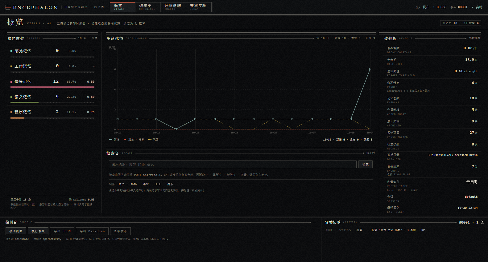

| 编年史 | 纤维追踪 |
| --- | --- |
| 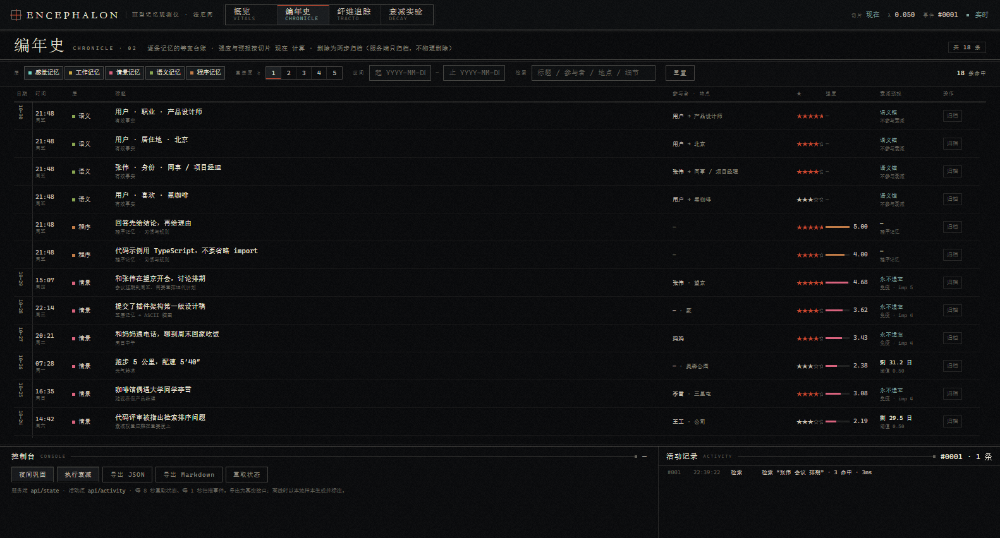 | 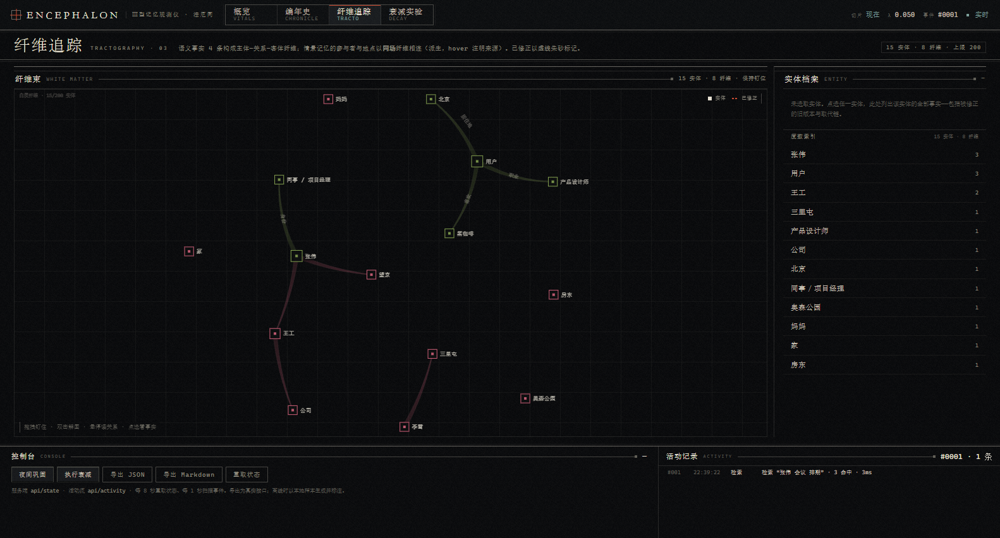 |

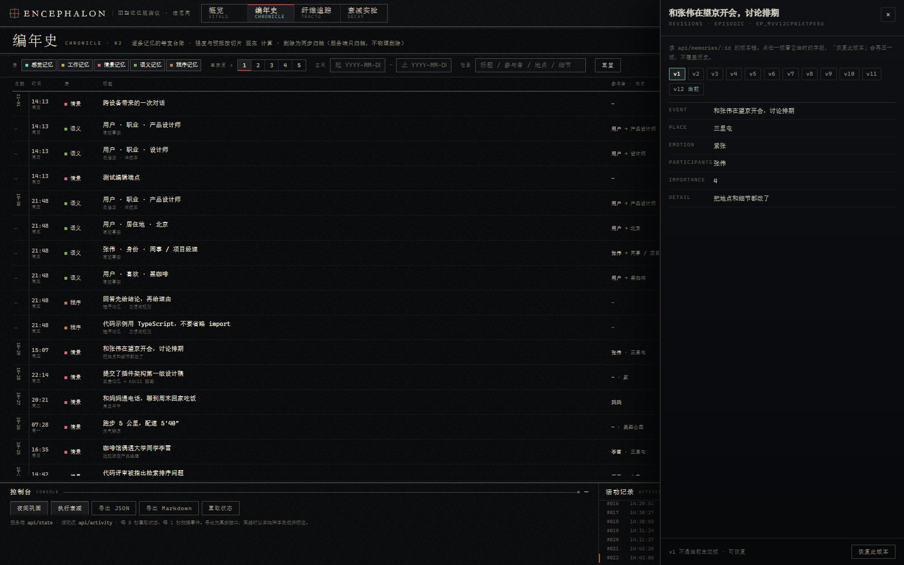

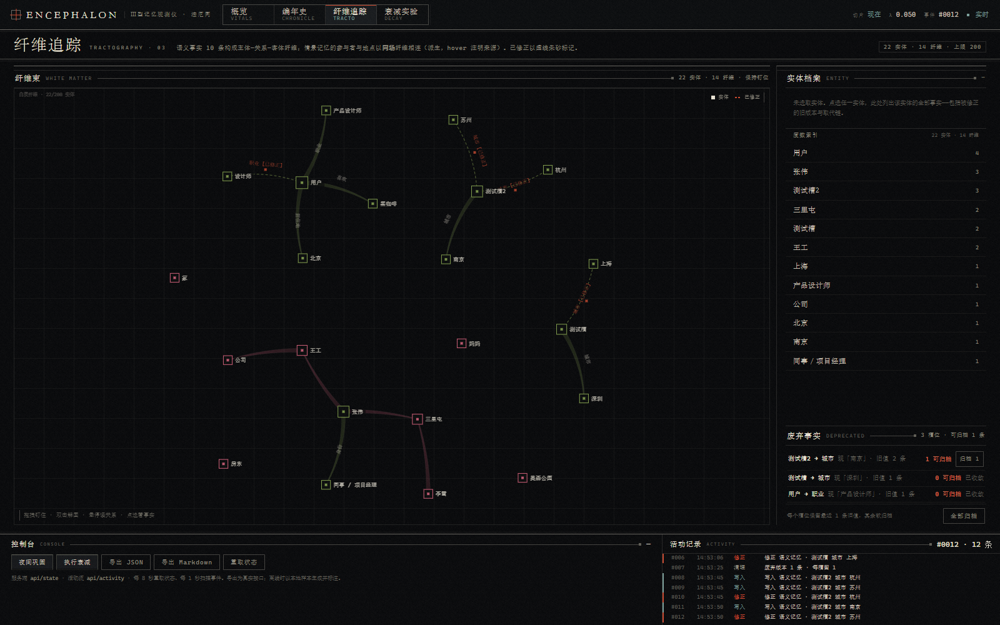

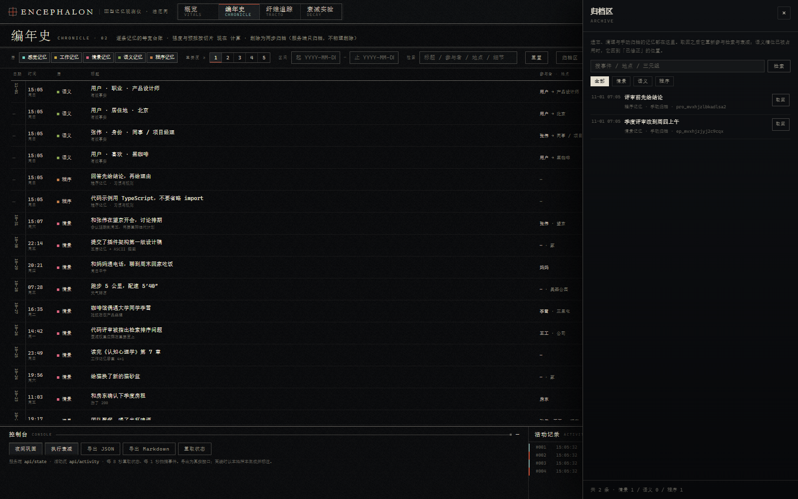

| 衰减实验 | 手机（390 px） |
| --- | --- |
| 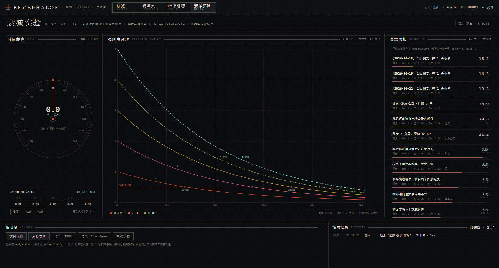 | 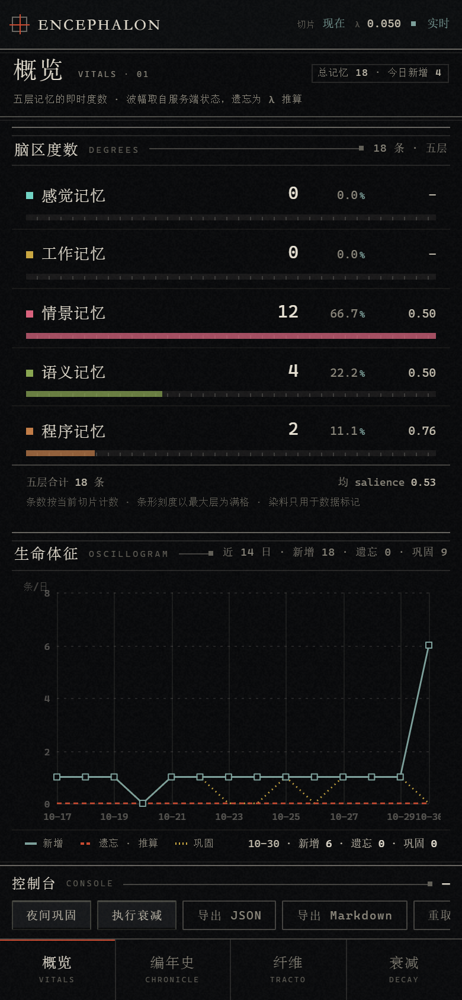 |

### 6.3 3D 记忆观测仪

- `web/brain-3d.html`：开发版，`vendor/three.global.min.js` 外链，作为插件静态资源由 `/deepseek-brain/brain-3d.html` 提供，读实时 `/api/state`。
- `dist/deepseek-brain-3d.html`：构建产物，three.js 内联进同一个文件，双击即开、离线可用，此时用内置 20 条演示记忆。

```bash
node tools/build-3d.mjs      # 生成 dist/deepseek-brain-3d.html
```

**这台仪器做什么（不是装饰动画）**

| 屏幕上的东西 | 背后的真实运算 |
| --- | --- |
| 每枚 engram（记忆痕迹）一颗多棘核 | 一条真实记忆。核的尺寸 ∝ `importance`、亮度 ∝ `salience`、棘丝条数 ∝ 重要度、棘长 ∝ `strength`；全部由 `api/state` 的同名字段驱动 |
| 五层形态不同：感觉=彗星、工作=环链、情景=多棘星、语义=晶格、程序=双楔 | 层的语义差异；语义晶格的连线是真实三元组与共享实体的边 |
| 核的位置永远固定 | FNV-1a 确定性寻址（见 `docs/API.md` §7）：同一条记忆每次刷新都落在同一格，你看到的刻度可被复现 |
| 点击任何一枚 → 右侧「目镜」 | 弹出该条记忆的完整字段：`id / slot u,v / 盘内 r,θ / anchor / ageDays / strength / salience / hits / ts / 遗忘预报` |
| 目镜里的「修订史 v1…vN」 | `GET /api/memories/:id` 的版本链：点开任一版看它当时的字段，`恢复此版本` 会再压一版而不是覆盖历史；`重要度 −/+` 走 `PATCH` |
| 底板上的「时间切片」与转盘 | 拖动即 `GET /api/state?at=±Nd`，整具标本按那一时刻重新计算强度，随时可回到 `now` |
| 顶栏 `事件序号`、观测条脉冲 | `GET /api/activity?since=` 的增量：Agent 每次检索/写入/遗忘都在标本上打出一次脉冲 |
| 检索台 | 真的 `POST /api/recall`，命中项按 `score` 亮起并连出白质纤维束 |
| 「睡眠 / 衰减 / 遗忘」压印按钮 | 真的 `POST /api/sleep`、`/api/decay`、`/api/forget`，迁移与归档在标本上留下路径与残影 |
| 归档环里的往返 | 底板外环按五层切成五段扇区（每段用该层染料，扇区中点常显「感觉 / 工作 / 情景 / 语义 / 程序」小字——标签方向跟着相机转，但半径固定在标本外圈，所以任何方位角下五个都在、互不遮挡），`forget` / `decay` 让 engram 缩着飞向**自己那一段**；`restore` 沿同一路径长回来，`undo` 再反向飞出去——落点由 `archiveAngle(layer, slot.u)` 决定，不是随机角度 |

**三种模式**：`观测`（全景标本）、`目镜`（选中单条记忆的切片）、`剖面`（切开半球看深部结构）。

- **剖面**不是隐藏半个半球：一块真裁剪面（`renderer.localClippingEnabled` + `THREE.Plane`）从额极以缓动扫到纵裂，切到哪儿皮质就少到哪儿；切面行进时内壁的雾状背面同时收暗，切面读成一张干净的薄片。相机同时用 1.05 s 飞到侧位，退出剖面自动飞回全景。
- **检索**沿白质纤维束跑：脉冲头前面走，走过的路段留下一条渐隐的尾迹（单 `LineSegments` 动态缓冲，`depthTest:false`，所以能透过皮质看到），海马索引环先被点亮一整圈，再按 `score` 从束上不同高度剥出侧支——越靠后越细越短，不是终点放烟花。
- **目镜的「记忆原文」**：情景记忆给的是当初那句话（事件正文 + 地点 + 细节引文 + `T / WHERE / WHO / FEEL` 四格）；语义记忆给 `主体 → 关系 → 客体` 的三段式与 `[已修正]` 血缘；程序记忆给规则原文与命中次数。下面才是寻址与分解数字。

| 剖面（裁剪面扫到纵裂） | 检索轨迹与目镜 |
| --- | --- |
| 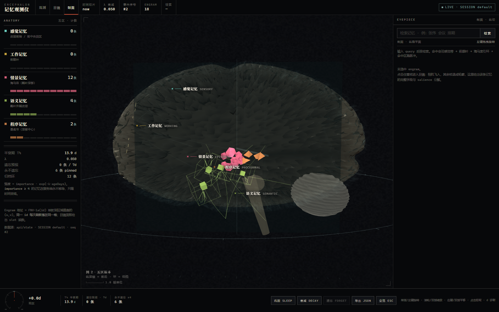 | 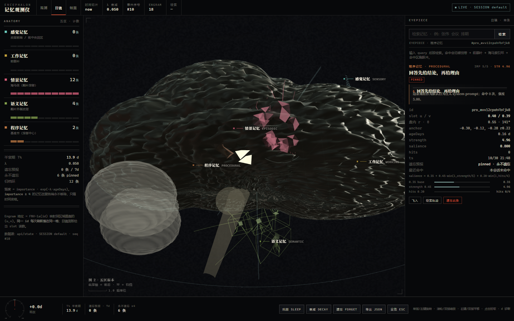 |

**手势（Pointer Events，鼠标与触屏同一套）**

| 操作 | 鼠标 | 触屏 | 效果 |
| --- | --- | --- | --- |
| 旋转 | 左键拖拽 | 单指拖拽 | 360° 环绕标本 |
| 缩放 | 滚轮 | 双指捏合 | 拉近看脑沟回与棘丝 |
| 平移 | 右键拖拽 | 双指拖拽 | 平移视点 |
| 选中 | 单击 engram 或左板层名 | 单指点选 | 相机飞入 + 目镜展开该条记忆 |
| 复位 | `Esc` / 「全景」 | 收起目镜 | 回到全景 |

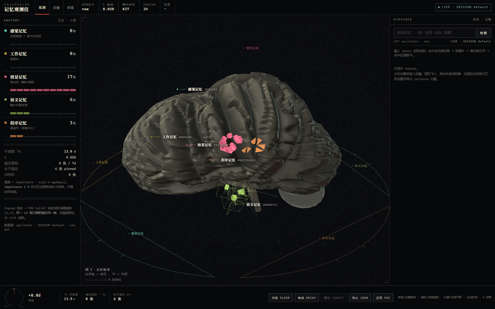

| 手机（390 px，真 device metrics） |
| --- |
| 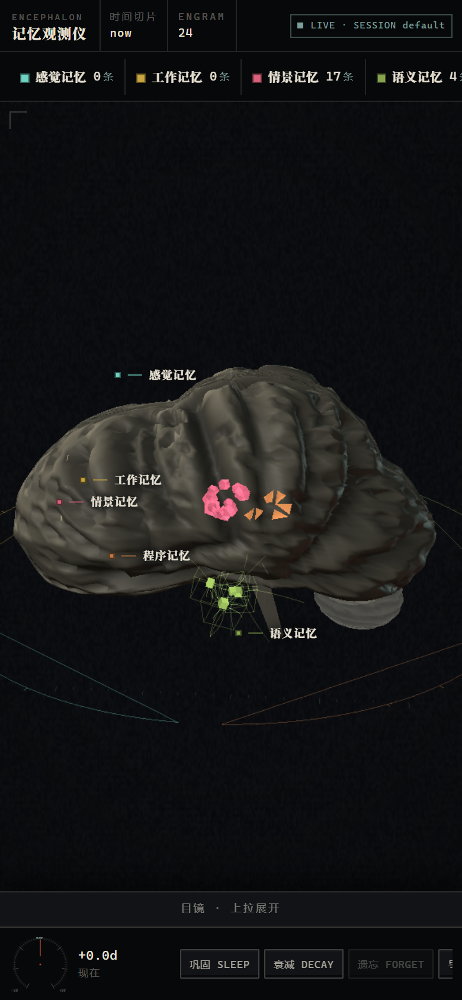 |

**几何与脑区映射**（`BRAIN = {AX 1.40, AY 1.46, AZ 2.02}`）

- 皮层不是一颗椭球，而是 **四叶 + 三个极部** 的隐式场并集：`LOBE_C` 里额 `[0,0.06,0.50, 0.86,0.84,0.80]`、顶 `[0,0.26,-0.20, 0.92,0.92,0.72]`、枕 `[0,-0.06,-0.68, 0.78,0.64,0.50]`、颞 `[-0.66,-0.30,0.10, 0.50,0.40,0.72]`（按半球镜像）给主体，另加额极 `[0,-0.02,0.88, 0.46,0.42,0.30]`、颞极 `[-0.56,-0.34,0.66, 0.33,0.27,0.28]`、枕极 `[0,-0.02,-1.00, 0.36,0.30,0.24]` 三个更小更靠外的椭球；polynomial smooth-max（`k = 0.115`）做圆角并集，再沿每个顶点方向二分 16 次求边界半径 `lobeRadius()`，`LOBE_K` 把并集最大半径归一到 1。极部因此是锥形收口，不是两块等高的球面。
- 两个**闭合**半球：内侧顶点被 softMax 折到 `x ≈ ±gapHalf` 的墙面上，两壁之间是真缝（纵裂）；脑底面在颅底处压平（`py < -0.30` 后的 0.58 折减）。
- 沟回由**带分叉的一级沟骨架树**驱动：`SULCI` 里的 18 条折线（中央沟主干 + 上支 + 下支、中央前/后沟、外侧裂主干 + 升支 + 后支、额上/额下沟、顶内沟、顶上沟、顶枕外侧支、颞上/颞下沟、顶枕沟、距状沟、扣带沟）都定义在单位球方向空间；每个顶点一次遍历算出到最近骨架的角距离 `d1`、到次近骨架的 `d2` 与按 `w=exp(−(d/0.30)²)` 融合的相位——
  - 一级沟：`d1≈0` 处按各自宽度开深槽 `exp(−(d1/w)²)·depth`；
  - 次级沟：相位 = 加权平均的 `(弧长·1.05 + d·17.0)`，所以脑回走向在两条沟的势力边界上是**平滑过渡**的，不会突然换向；
  - 三级沟：同相位倍频 `2.6×`，压掉同心圆；
  - **Voronoi 顶冠**：`wall = exp(−((d2−d1)/0.055)²)` 在两条沟的分界线上把皮层抬起来，于是两沟之间是圆隆的脑回顶，而不是平台；
  - **叶区调制**：相位再乘一个由前后位置决定的 `gf = 1 − 0.15·smoothstep(0, 0.90, pz) + 0.20·smoothstep(0.10, −0.85, pz)`——额极更宽（`gf≈0.85`）、枕极更细（`gf≈1.20`），治掉原先「脑回宽度整齐划一」的塑料感。
  合成 `bump = (1−sul)·0.55 + 0.45·warpA + 0.18·wall`，`disp = 1 + 0.094·bump − 0.118·sul`。中央沟与外侧裂因此是真正的分叶深沟，不是画上去的线。
- 半球细分 `seg: [224, 168]`（低画质 `[104, 80]`），约 10 万顶点/半球；加载时一次性算完位移与顶点色，桌面端 `DOMContentLoaded ≈ 1.2 s`。
- 颅顶弧线单列一条：`y -= 0.125 * smoothstep(0.18, 0.98, |pz|) * lobe`，中段最高、额极与枕极一起下沉；同时 `x *= 1 - 0.13*smoothstep(0.34,1.0,|pz|)` 让极部收窄，从上方看是卵形而不是跑道形。
- 小脑是两半球 + 蚓部三个网格（共用一份叶片条纹几何），脑干与桥脑独立。
- 皮层用 `MeshStandardMaterial` 承接真实定向光（key/fill/rim 三灯 + 半球光），顶点色承载沟回的「沟底变暗」；engram 用 `depthTest:false` 的 X 光叠加，所以能隔着皮质看到深部结构——这是仪器语义，不是穿模。
- 剖面切面是**解析式着色器**：`vUv` 上算灰质带（`smoothstep(rim-0.19, rim-0.05, r)`）、皮质-白质交界亮线、胼胝体弧、穹窿、侧脑室、基底节，再叠一层 hash 颗粒与沿灰质带的沟刻痕；不经过纹理，所以没有色彩空间损耗。
- 检索束是**屏幕空间加粗管线**：每段生成 6 个顶点（两个三角形），顶点着色器把端点投到 clip space、按屏幕法向撑开 `aWidth` 像素，宽度沿尾迹衰减；单 `Mesh` + 动态缓冲，`depthTest:false`，能透过皮质看到整条束。
- 五个脑区锚点：感觉 `(-0.42, 0.86, 1.12)`、工作 `(0.48, 0.34, 1.60)`、情景 `(-0.88, -0.30, 0.14)`、语义 `(1.14, -0.40, 0.06)`、程序 `(-0.30, -0.12, -0.28)`；半径 .34/.30/.26/.38/.22。

| 检索束（加粗管线，命中瞬间） |
| --- |
| 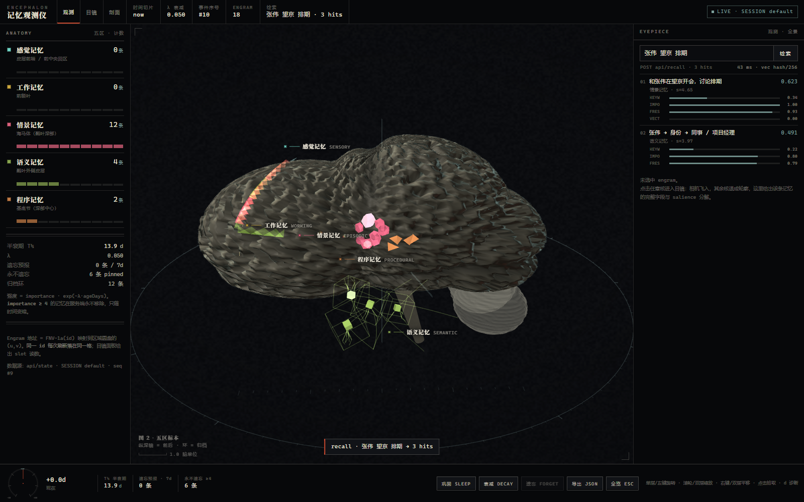 |

| 凑近看皮层（沟回沿一级沟骨架铺开） |
| --- |
| 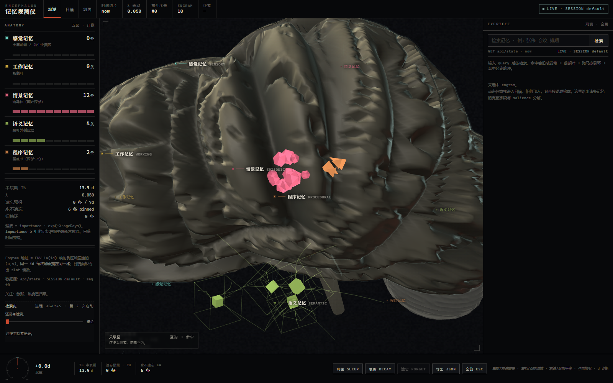 |

**性能（目标 60 fps，含移动端）**

| 手段 | 说明 |
| --- | --- |
| 实例化 engram 核 | 每层一个 `InstancedMesh`（上限 512），一次 draw call 画完整层；尺寸/亮度/明暗走实例属性，不在帧内重建几何 |
| 线条合并 | 纤维束、环、刻度全部并进一个 `LineSegments`（`LINE_SEGS` 上限），一次提交 |
| 脉冲池 | 检索/写入的激活脉冲是固定容量的 `Points` 池，循环复用，绝不 `new` |
| 零帧内分配 | 渲染循环复用模块级 `Vector3`/`Color` 临时量 |
| 拾取开销 | 射线只与每层的 picked proxy 求交，不打高面数皮质 |
| 画质分档 | `hardwareConcurrency ≤ 4 / dpr×width > 2600 / 视口短边 < 720` 时降级：关抗锯齿、`pixelRatio` ≤ 1.5、分段 96×72、关菲涅尔壳与颗粒 |
| 离屏暂停 | `document.hidden` 时停渲染，轮询也暂停 |
| 抗抖动 | 惯性阻尼；`prefers-reduced-motion` 下镜头跳切、不做长动画 |
| 调试 | 按 `d` 显示 HUD：draw calls / triangles / 帧耗 / 实例数 |

---

## 7. 测试与调试

```bash
node --test test/            # 62 个用例：分层算法 / 存储 / 记忆系统 / HTTP API / 活动流 / 插件契约 / 前端产物
node tools/demo.mjs          # 灌入 20 条演示记忆并打印脑图
DEEPSEEK_BRAIN_DIR=/tmp/brain node tools/demo.mjs   # 用临时数据目录，不碰真实记忆
```

用例覆盖：

| 文件 | 覆盖 |
| --- | --- |
| `test/layers.test.js` | 实体抽取、注意闸门、话题栈与小话题过滤、情景衰减与钉住、语义别名/冲突历史、程序记忆去重、巩固摘要、检索权重、ASCII 对齐、Markdown 档案 |
| `test/store.test.js` | 原子写、备份轮转上限、损坏文件隔离与恢复 |
| `test/memory.test.js` | 落盘/重启后记忆存活、观察闸门、recall、软删除、衰减清理、睡眠巩固、`apiState` 契约、演示数据、prompt 块、配置夹取 |
| `test/activity.test.js` | 活动流：seq 单调、payload 不能伪造 `seq/kind`、未知 kind 回退、环形缓冲上限、`since()` 只返回增量 |
| `test/server.test.js` | 全端点、CORS/预检、静态资源、路径穿越拒绝、坏 JSON 结构化报错、`salience` 派生、时间旅行、`forgetInDays` 预报、`POST /api/recall` |
| `test/plugin.test.js` | cordis 契约、14 个工具 schema 只使用 DSH 支持的 JSON Schema 子集、端到端工具调用、`session/event` 捕获、prompt 注入 |
| `test/frontend.test.js` | 两个页面无远程依赖、内联脚本可编译、3D 页引用 vendor + `api/state` + 五层名称、`dist` 单文件把 three.js 内联且无外链 |

调试入口：

- `GET /deepseek-brain/api/health`：数据目录、各层条数、备份数、向量状态、`warnings`。
- 脑图底部「记忆健康面板」就是同一份统计的可读版。
- 想看某条为什么被召回：`recall` 的 `parts` 里有 `keyword / importance / freshness / vector` 四个分量。
- 想看引擎刚刚做了什么：`GET /api/activity?since=<seq>`，观测仪底部的「活动记录」就是它的渲染。
- 想验证遗忘：`GET /api/state?at=%2B30d` 看 `forgetInDays` 归零的那几条，再 `POST /api/decay` 让它们真的进归档。
- 插件初始化失败不会炸掉会话，错误进 `memory.warnings` 并在 `api/health` 里可见。

### 7.1 本机实测记录

| 项 | 结果 |
| --- | --- |
| `node --test test/` | 62 pass / 0 fail |
| 真实安装 | `dsh plugin --profile brain-selftest add ./deepseek-brain` → pnpm link 成功，`dsh.profile.bundles` 自动写入 `deepseek-brain`，`dsh --dump-config` 出现 `- id: deepseek-brain` |
| 真实 HTTP | `dashboard.html` / `brain-3d.html` / `vendor/three.global.min.js` / `api/state` 全部 200，`api/state` 10 KB（v2 增加了 salience/预报/活动序号），regions 计数与库内条数一致 |
| 真实检索 | `POST /api/recall {"query":"张伟 会议 排期"}` → 3 命中，top 0.624，`tookMs` 实测 31–46 ms；活动流里同一条事件带回 `parts/strength/title`，所以别人的检索在观测仪上也不是空条 |
| 遗忘预报 | importance 1 的新条目 `forgetInDays = 13.86`；`?at=%2B10d` 后同一条变 `3.86`；`importance ≥ 4` 一律 `null`（pinned） |
| 20 天剧本（λ=0.08） | sleep `{"migrated":3,"compressed":0,"pruned":0,"digests":0,"kept":9}`，重载后 episodic 9 条、archive 与 backups 一致 |
| 3D 交互 | CDP 真实点击 engram：相机飞入 + 目镜列出 `id / slot u,v / 盘内 r,θ / anchor / ageDays / strength / salience / hits / ts / 遗忘预报`；`飞入 / 检索轨迹 / 遗忘此条` 三个按钮均打到真实端点 |
| 移动端 | 390×844（CDP `Emulation.setDeviceMetricsOverride`）下观测仪四页无横向溢出、3D 竖屏不裁两颞侧，目镜改为底部抽屉 |

3D 页另外有一份离线冒烟：`web/brain-3d.html` 复制到没有 `vendor/` 的目录会显示可读错误卡而不是白屏。

---

## 8. 目录

```
deepseek-brain/
├── cordis.patch.yml          # DSH bundle 插入声明
├── package.json              # main: lib/index.js, dsh.bundle.patch
├── lib/
│   ├── index.js              # 插件入口：14 个工具 + prompt 注入 + 事件捕获 + Web 挂载 + 自主遗忘定时器
│   ├── memory.js             # MemorySystem：五层编排、配置、状态、prompt 块、演示数据、遗忘预报
│   ├── store.js              # 原子写、备份轮转、损坏恢复
│   ├── sensory.js            # 感觉缓冲 + 实体抽取 + 注意闸门
│   ├── working.js            # 话题栈 + 话题检测
│   ├── episodic.js           # 情景记忆 + 指数衰减
│   ├── semantic.js           # 三元组图谱 + 别名合并 + 冲突修正
│   ├── procedural.js         # 规则/习惯
│   ├── retrieval.js          # 检索引擎与分数拆解
│   ├── consolidation.js      # 睡眠式巩固
│   ├── activity.js           # 认知活动流（3D / 观测仪的事件源）
│   ├── vector.js             # 可选向量召回（hash / lancedb）
│   ├── render.js             # ASCII 脑图与健康面板
│   ├── snapshot.js           # Markdown 记忆档案
│   └── server.js             # 观测仪 + JSON API（含 ?at= 时间旅行与 /api/recall）
├── web/
│   ├── brain-3d.html         # 3D 记忆观测仪（开发版，外链 three）
│   ├── dashboard.html        # 记忆观测仪（单文件）
│   └── vendor/               # three.js 全局构建
├── dist/deepseek-brain-3d.html  # 单文件 3D 观测仪（构建产物，three 内联）
├── tools/                    # serve（本地预览）/ demo / build-3d / build-global-three
├── test/                     # 61 个 Node 原生测试
├── docs/
│   ├── API.md                # 前端契约 v2.1（端点 + state 结构 + 确定性 engram 寻址）
│   ├── DESIGN-v2.md          # 观测仪设计说明：形态学、色彩、排版、事件编排、性能预算
│   ├── EXAMPLES.md           # 示例：记忆 / 检索 / 可视化 / 观察大脑正在想什么
│   └── screenshots/          # 观测仪四页、3D 目镜与移动端截图
```

## 9. 边界

- 记忆只存在本机，插件不做任何网络请求；观测仪监听 `127.0.0.1`。
- 自动捕获有闸门（问候、过短、纯提问不写入），避免垃圾记忆污染；仍建议用 `importance` 与 `brain_forget` 维护。
- 遗忘是**真的**：`autoDecayMinutes`（默认 30）到点自动 `decayPass()`，跌破阈值的记忆移入 `archive.json`；3D 里那枚 engram 会随之消失，而不是只变暗。
- `vector` 默认关闭。`hash` provider 只是字符级哈希相似度，不是真正的语义嵌入；接 LanceDB 时可以注入自己的 embedding。
- Windows 上文件写入走「删目标再 rename」的回退路径，极端断电窗口内可能丢一次写入，但有备份兜底。
- 3D 页面在 `file://` 下无法访问 API，会自动切到内置演示记忆；实时数据请走 `brain_dashboard` 给出的 URL。
- 3D 皮质是**程序化近似**，不是医学模型：叶形来自四椭球并集，沟回来自 18 条一级沟骨架（含分叉）+ 平行相位 + Voronoi 顶冠；一级沟的位置是手调的近似解，脑回在顶叶与颞叶交界一带仍偏放射状，额极/枕极偏圆钝，小脑叶片仍是正弦条纹；远看合格，贴近看依然是「生成物」。engram 用 X 光叠加（`depthTest:false`）是刻意的仪器语义，不是穿模。
- 曾尝试用同一高度场烘焙切线空间法线贴图来补近距离细节，**已放弃**：次级沟在球面 UV 上的周期只有约 6 px，224/320 分辨率下会采样出摩尔纹，画面变成一片「鳞片」；真要做需要位移贴图 + 三平面投影，成本远超收益。现在靠 224×168 细分 + 顶点位移解决轮廓，近看仍是光滑的。
- 时间旅行只重算**强度与预报**，不会真的把记忆写回过去；`?at=` 是只读的时间切片。
- Windows PowerShell 的 `Invoke-RestMethod` 默认按 ANSI 发 body，中文会变成 `??`；用 `[Text.Encoding]::UTF8.GetBytes($body)`（见 `docs/EXAMPLES.md`）。
- 390 px 下观测仪把左侧脑区表收成横向条、把目镜改成底部抽屉；3D 页在竖屏会把标本按比例拉远，避免裁掉两颞侧，代价是上下留白。

MIT License.
